# OrgMind: Enterprise Company Brain — Technical Documentation
> **Track 3: Company Brain (FalkorDB Hackathon 2026)**  
> *Transforming Institutional Memory, Architecture Decisions, and Incident Response into an Active Knowledge Graph.*

---

## 1. Architectural Blueprint & System Overview

OrgMind models the entire engineering organization as an active, queryable Knowledge Graph stored in **FalkorDB**, utilizing its **GraphBLAS** linear algebra sparse-matrix engine for sub-15ms multi-hop traversals.

Unlike conventional Vector RAG—which retrieves isolated text chunks that frequently produce hallucinations, confuse legacy RFCs with modern ADRs, and fail to calculate downstream microservice dependencies—OrgMind provides:
1. **Deterministic Multi-Hop Traversal**: Trace cascading service failures up to 5 hops deep.
2. **Explicit Contradiction Modeling**: First-class `Claim` nodes linked via `[:CONFLICTS_WITH]` and `[:SUPERSEDED_BY]` edges.
3. **Automated Architectural Governance**: Blocks pull requests that violate ratified architecture decision records (ADRs).
4. **Instant War Room Mobilization**: Automatically calculates incident blast radiuses and dispatches targeted on-call squads via pre-formatted Slack alerts.
5. **Grounded Graph-RAG Copilot**: High-speed AI inference powered by open-source LLMs (Meta Llama 3.2, Mistral 7B, DeepSeek R1, Ollama local) backed by live FalkorDB Cypher queries.

```mermaid
flowchart TD
    subgraph ClientLayer ["Client Presentation Layer (Vite + React + Tailwind)"]
        UI_Home["Home Hero & Architecture Showcase"]
        UI_Tour["Dedicated Feature Tour Page (/tour)"]
        UI_Canvas["Interactive Subgraph Canvas (Vis.js / Force-Graph)"]
        UI_Containers["3-Container Modular Workspace (Slider 1, 2, 3)"]
        UI_Copilot["Global Open-Source AI Copilot Chat Drawer"]
    end

    subgraph APILayer ["FastAPI Intelligence Gateway (Port 8001)"]
        API_Health["GET /api/health (Redis/FalkorDB Ping)"]
        API_Overview["GET /api/overview (Topology & KPIs)"]
        API_Investigate["POST /api/investigate (Multi-hop blast radius & tools)"]
        API_Chat["POST /api/chat (Graph-RAG Open LLM Inference)"]
        API_Heal["POST /api/claims/correct (1-Click Graph Mutation)"]
        API_Ingest["POST /api/ingest/json & /text (Company Importer)"]
    end

    subgraph IntelligenceLayer ["Knowledge & Reasoning Layer"]
        GraphRAG["Graph-RAG Multi-Hop Context Extractor"]
        LLM_Router["Open-Source LLM Router (Llama 3.2 / Mistral / DeepSeek / Ollama)"]
        EntityResolver["FalkorDB Entity & Fuzzy Matcher"]
        AgentTools["Verifiable Cypher Tool Traces Engine"]
    end

    subgraph StorageLayer ["FalkorDB In-Memory Graph Core (Port 6379)"]
        GraphBLAS["GraphBLAS Sparse Matrix Engine"]
        Nodes_Services["(:Service) & (:Team) Nodes"]
        Nodes_ADR["(:Decision) & (:Policy) Nodes"]
        Nodes_Incident["(:Incident) & (:Person) Nodes"]
        Nodes_Claims["(:Claim) Nodes with [:CONFLICTS_WITH] Edges"]
    end

    ClientLayer --> APILayer
    APILayer --> IntelligenceLayer
    IntelligenceLayer --> StorageLayer
```



---

## 2. FalkorDB vs. Vector RAG: Why Graph Databases are Mandatory

| Dimension | Standard Vector RAG | OrgMind on FalkorDB |
| :--- | :--- | :--- |
| **Downstream Blast Radius** | Fails to traverse transitive dependencies. Only retrieves services mentioned in the exact text snippet. | Traverses `<-[:DEPENDS_ON*1..5]-` paths via GraphBLAS matrix multiplication in **< 15ms**. |
| **Conflicting Architectural Truths** | Averages contradictory text embeddings together (e.g. RFC-102 symmetric HMAC vs ADR-042 RS256). | Explicit `[:CONFLICTS_WITH]` edges flag disagreements; state machine deterministically separates `active` from `superseded`. |
| **Architectural Drift Guard** | Cannot block CI/CD pipelines deterministically; prone to hallucinations. | Performs rule-bound Cypher verification against ratified ADRs and returns hard merge blocks with exact provenance. |
| **Expert Discovery** | Matches keywords to random past authors regardless of status. | Computes degree-weighted SME rankings joining direct ownership, incident response commander history, and ADR authorship. |
| **Institutional Memory Mutation** | Cannot edit learned knowledge without re-embedding the entire corpus. | Deterministic Cypher updates: `SET stale.status = 'superseded'` and creates `[:SUPERSEDED_BY]` audit edges in 1 click. |

---

## 3. Graph Schema Specification

The OrgMind database schema is modeled as a typed property graph in FalkorDB:

### Node Labels
1. **`Service`**: Microservice or software component.
   - Properties: `id` (string), `name` (string), `tier` (int), `criticality` ("P0"|"P1"|"P2"), `status` ("healthy"|"degraded"|"incident"), `repository_url` (string).
2. **`Team`**: Engineering squads and operational divisions.
   - Properties: `id` (string), `name` (string), `department` (string), `slack_channel` (string).
3. **`Person`**: Engineers, tech leads, and leadership.
   - Properties: `id` (string), `name` (string), `role` (string), `email` (string), `oncall_status` (bool).
4. **`Decision`**: Architecture Decision Records (ADRs) and RFCs.
   - Properties: `id` (string), `title` (string), `status` ("approved"|"proposed"|"deprecated"), `approved_by` (string), `effective_date` (string).
5. **`Incident`**: Historical or active outages.
   - Properties: `id` (string), `title` (string), `severity` ("P0"|"P1"|"P2"), `date` (string), `root_cause` (string), `postmortem_url` (string).
6. **`Claim`**: First-class atomic knowledge assertions with provenance.
   - Properties: `id` (string), `subject_id` (string), `predicate` (string), `object_value` (string), `status` ("active"|"superseded"), `valid_from` (string), `valid_to` (string).
7. **`Document`**: Raw source evidence files (RFCs, post-mortems).
   - Properties: `uri` (string), `title` (string), `hash` (string).

### Relationship Types
- `(:Person)-[:MEMBER_OF]->(:Team)`
- `(:Team)-[:OWNS]->(:Service)`
- `(:Person)-[:OWNS]->(:Service)`
- `(:Service)-[:DEPENDS_ON]->(:Service)`
- `(:Incident)-[:AFFECTS]->(:Service)`
- `(:Person)-[:WORKED_ON {role: string}]->(:Incident)`
- `(:Decision)-[:GOVERNS]->(:Policy)`
- `(:Decision)-[:CHANGES]->(:Service)`
- `(:Document)-[:SUPPORTS]->(:Claim)`
- `(:Claim)-[:ABOUT]->(:Service)`
- `(:Claim)-[:CONFLICTS_WITH]->(:Claim)`
- `(:Claim)-[:SUPERSEDED_BY {reason: string}]->(:Claim)`

---

## 4. Core Cypher Intelligence Engine

### A. Multi-Hop Downstream Blast Radius
Calculates all transitive microservices disrupted if a critical service degrades:
```cypher
MATCH path = (root:Service {id: $service_id})<-[:DEPENDS_ON*1..5]-(dependent:Service)
RETURN root.name AS root,
       dependent.name AS dependent,
       dependent.criticality AS criticality,
       length(path) AS depth
ORDER BY depth ASC;
```

### B. Conflicting Knowledge & ADR Divergence Detection
Identifies contradictory statements regarding the same subject and predicate:
```cypher
MATCH (a:Claim)-[:ABOUT]->(s:Service {id: $service_id}),
      (b:Claim)-[:ABOUT]->(s)
WHERE a.predicate = b.predicate AND a.id <> b.id
OPTIONAL MATCH (d1:Document)-[:SUPPORTS]->(a)
OPTIONAL MATCH (d2:Document)-[:SUPPORTS]->(b)
OPTIONAL MATCH (a)-[cf:CONFLICTS_WITH]->(b)
RETURN a, b, d1, d2, cf, s;
```

### C. Degree-Weighted Expert & Reviewer Scoring
Ranks personnel with verified operational authority and historical incident context:
```cypher
MATCH (p:Person)-[:OWNS]->(s:Service {id: $service_id})
RETURN p.name AS name, p.role AS role, p.email AS email, 'Direct Service Owner' AS reason, 5 AS score
UNION
MATCH (p:Person)-[w:WORKED_ON]->(i:Incident)-[:AFFECTS]->(s:Service {id: $service_id})
RETURN p.name AS name, p.role AS role, p.email AS email, ('Incident Responder (' + w.role + ')') AS reason, 4 AS score
UNION
MATCH (p:Person)-[:AUTHORED]->(d:Decision)-[:CHANGES]->(s:Service {id: $service_id})
RETURN p.name AS name, p.role AS role, p.email AS email, ('Author of ' + d.id) AS reason, 4 AS score
ORDER BY score DESC;
```

### D. Deterministic 1-Click Graph Healing Mutation
Heals institutional memory by superseding outdated claims and updating graph audit edges:
```cypher
MATCH (stale:Claim {id: $claim_id})
SET stale.status = 'superseded',
    stale.valid_to = date(),
    stale.reviewed_by = $reviewed_by,
    stale.reviewed_at = datetime()
WITH stale
MATCH (stale)-[cf:CONFLICTS_WITH]->(approved:Claim)
DELETE cf
CREATE (stale)-[:SUPERSEDED_BY {reason: 'Superseded via human review in OrgMind'}]->(approved)
RETURN stale;
```

---

## 5. REST API Specifications

The FastAPI server runs on port `8001` with automated Swagger docs at `/docs`:

### `GET /api/health`
Verifies connection to FalkorDB via Redis protocol.
- **Response**: `{"status": "ok", "falkordb": "connected", "result": "pong"}`

### `GET /api/overview`
Retrieves enterprise counts, KPIs, and complete dependency graph for visual canvas.
- **Response**:
```json
{
  "company_name": "Nexora Cloud",
  "counts": {
    "services": 6,
    "teams": 4,
    "people": 6,
    "incidents": 1,
    "active_conflicts": 0,
    "decisions": 1
  },
  "dependency_graph": {
    "nodes": [...],
    "edges": [...]
  }
}
```

### `POST /api/investigate`
Executes multi-hop entity resolution, blast radius calculation, and verifiable tool traces.
- **Payload**:
```json
{
  "question": "Review PR #318: Revert Payments authentication to symmetric HMAC key headers.",
  "mode": "architect"
}
```
- **Response**:
```json
{
  "question": "...",
  "target_service": "svc_payments",
  "answer": "### Investigation Report: Payments Service ...",
  "tool_traces": [
    { "tool": "resolve_entities", "output": { "services": ["svc_payments"] } },
    { "tool": "get_ownership", "output": { "team_name": "Core Platform" } },
    { "tool": "trace_dependencies", "output": { "blast_radius": ["svc_checkout", "svc_billing"] } }
  ],
  "subgraph": { "nodes": [...], "edges": [...] }
}
```

### `GET /api/chat/models`
Returns available open-source foundation models for the interactive Copilot.
- **Response**:
```json
{
  "models": [
    { "id": "llama-3.2", "name": "Meta Llama 3.2 (Open Source)", "hf_model": "meta-llama/Llama-3.2-3B-Instruct" },
    { "id": "mistral-7b", "name": "Mistral 7B Instruct (Open Source)", "hf_model": "mistralai/Mistral-7B-Instruct-v0.3" },
    { "id": "deepseek-r1", "name": "DeepSeek R1 (Open Source Reasoning)", "hf_model": "deepseek-ai/DeepSeek-R1-Distill-Qwen-1.5B" },
    { "id": "ollama", "name": "Ollama Local (Localhost:11434)", "hf_model": "llama3.2" }
  ]
}
```

### `POST /api/chat`
Performs Graph-RAG query expansion, gathers factual Cypher context, and streams grounded response.
- **Payload**:
```json
{
  "message": "Why is PR #318 blocked?",
  "model": "llama-3.2",
  "history": []
}
```
- **Response**:
```json
{
  "reply": "### 🛡️ Architectural Drift Review: PR #318\n\n❌ Status: Merge Blocked by AI Staff Architect Guard ...",
  "model_used": "Meta Llama 3.2 (Open Source) (FalkorDB Graph-RAG Engine)",
  "graph_context": {
    "services": [...],
    "decisions": [...],
    "latency_ms": 9.3
  },
  "latency_ms": 9.3
}
```

---

## 6. Frontend Container Architecture

The UI is built with a strictly structured, luxury obsidian `#050505` and warm amber `#e0a35c` aesthetic:

1. **Top Viewport — Interactive Subgraph Canvas**:
   - Physics-stabilized force-directed network rendered via Vis.js.
   - Interactive node selection with side-drawer property inspector.
   - Direct link to FalkorDB visual browser on port 3000.

2. **Container 1 — Command Center & Capability Slider**:
   - `AI COMMAND & INVESTIGATION` operational header.
   - Step 1 Slider with interactive pills `1`, `2`, `3` and `◀`/`▶` navigation:
     - Slide 1: Enterprise Architecture & Ownership
     - Slide 2: P0 Incident Blast Radius & War Room
     - Slide 3: PR Drift & CI/CD Architectural Guard
   - Dynamic prompt card, customizable query textarea, and `[ EXECUTE INVESTIGATION ]` button.
   - **Closes immediately after the execution form**.

3. **Container 2 — Dedicated Workspace & Operational Outcomes**:
   - Dynamic outcomes rendered according to the active capability:
     - Slide 1: Ownership resolution & Stale Claim Conflict Alert (with 1-click healing button).
     - Slide 2: P0 War Room Incident Commander, blast radius microservices list, and 1-click Slack Squad Dispatch copy button.
     - Slide 3: Blocked PR #318 review card citing ADR-042 and 1-click GitHub review markdown copy.

4. **Container 3 — Technical Audit Trail & Cypher Provenance**:
   - Collapsible formatted Cypher multi-hop query.
   - Auditable source documents (`RFC-102`, `ADR-042`, `INC-8812`) with provenance drawer.
   - Verifiable Graph Tools trace log.

5. **Global AI Copilot Drawer**:
   - Floating `[ ✦ Ask AI Copilot | Open Source AI ]` trigger.
   - Seamless model switcher between Meta Llama 3.2, Mistral 7B, DeepSeek R1, and Ollama.
   - Real-time GraphBLAS latency display (< 15ms).

---

## 7. Operational Runbook & Verification

### Running the Fullstack Stack
```bash
# 1. Start FalkorDB
docker compose up -d

# 2. Start Backend Gateway
PYTHONPATH=. ./venv/bin/uvicorn backend.main:app --host 0.0.0.0 --port 8001 --reload

# 3. Start Frontend Console
cd frontend && npm run dev
```

### Automated Graph Test Suite
```bash
PYTHONPATH=. ./venv/bin/pytest tests/test_queries.py -v
```
Verifies all 6 hackathon criteria:
1. `test_service_ownership_resolution` (Passes)
2. `test_multihop_blast_radius` (Passes)
3. `test_incident_history_correlation` (Passes)
4. `test_conflicting_claims_detection` (Passes)
5. `test_expert_scoring_degree_weighted` (Passes)
6. `test_agent_investigate_integration` (Passes)

---
*Created for the FalkorDB Hackathon 2026 — Track 3: Company Brain.*
